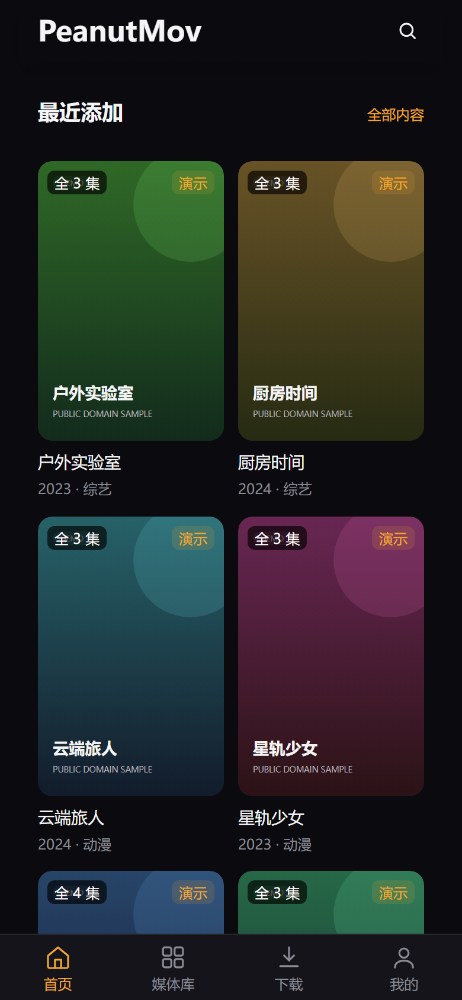

# PeanutMov

> 自用观影 App —— 本地优先、无服务端、无账号。Vue 3 + Capacitor，同时支持 Android App 与浏览器。

PeanutMov 是一个干净的个人播放器：把你自己的片源（NAS / 网盘 / 自建 Jellyfin）接进来，统一浏览、播放、下载、记录进度。所有数据存在本机 IndexedDB，不经过任何服务器。

内置一份公开版权演示片单（12 条公开版权样片，4 个分类），装好即可验证播放、字幕、下载等全部功能。



---

## 合规声明

**本项目不内置、不提供、不分发任何第三方影视内容与接口。**

- 唯一的预置内容是公开版权样片，仅用于功能演示。
- 不提供破解、盗版站点聚合、DRM 绕过、解析接口等任何规避版权保护的能力。
- 你添加的源与播放的内容由你自行负责，**仅可用于播放你拥有版权、已获授权，或明确允许公开访问的内容**。
- 所有数据仅保存在本机；无账号体系、无统计 SDK、无云端同步。

首次启动必须勾选「我已阅读并同意」才能进入 App，不同意时无法使用任何功能。

---

## 功能

| 模块 | 能力 |
| --- | --- |
| 片源管理 | 支持 `alist` / `webdav` / `jellyfin` / `site` 四类源与内置 `demo`；连接测试、健康检查（分级 + 自动降级）、排序、启用/禁用 |
| 订阅导入 | 解析订阅文本，导入前预览、去重、逐条勾选 |
| 媒体库 | 分类浏览、搜索、分页加载、离线可用（缓存优先） |
| 详情与剧集 | 多线路/多剧集、未播集置灰、离线剧集标记、收藏、下载入口 |
| 播放器 | hls.js 懒加载、DASH/DRM 拦截提示、字幕（SRT 转换）、倍速、手势（亮度/音量/进度）、全屏与横屏、续播、每 5s 记录进度 |
| 下载 | 队列调度、进度持久化、Android 落盘 / Web Blob 存 IndexedDB、离线播放 |
| 历史与收藏 | 继续观看、观看历史、收藏列表 |
| 投屏 | Android 原生 Intent 投屏，Web 下明确降级提示 |
| 设置 | 主题（深色/浅色/跟随系统）、播放偏好、数据备份与恢复、重置 |
| 合规 | 首启门禁、版本化合规声明 |

---

## 技术栈

- **框架**：Vue 3（Composition API + `<script setup>`）、TypeScript（strict）
- **构建**：Vite 6（hash 路由，产物 `dist/`）
- **状态**：Pinia
- **本地库**：IndexedDB（`idb`），唯一事实源
- **播放**：hls.js（懒加载）+ 原生 `<video>`，DASH 明确拦截
- **原生**：Capacitor 7（Filesystem / Share / ScreenOrientation / App / Network / StatusBar / KeepAwake）
- **测试**：Vitest + @vue/test-utils + happy-dom + fake-indexeddb

### 分层

```
views / components / player       表现层
stores (Pinia)                    状态层
services/*                        服务层（UI 唯一入口，不直接碰 DB / 不直接 fetch 源）
sources/* (SourceAdapter)         源适配层（协议差异全部收敛在此）
db/ · native/                     持久层 / 原生桥
```

---

## 快速开始

要求：Node.js 18+、npm。

```bash
npm install
npm run dev        # http://localhost:5173/
```

其他常用命令：

```bash
npm run build      # 类型检查 + 生产构建（产物 dist/）
npm run preview    # 预览构建产物
npm run typecheck  # vue-tsc + tsc
npm run test:run   # 单次运行全部测试
npm run test:cov   # 覆盖率
```

环境变量：复制 `.env.example` 为 `.env.local` 后按需修改（`.env*.local` 不入库）。Vite 仅注入 `VITE_` 前缀变量，勿在其中放真实凭据。

---

## Android 构建

```bash
npm run build
npx cap sync android
cd android && ./gradlew assembleDebug
```

产物：`android/app/build/outputs/apk/debug/app-debug.apk`。首次使用 Android 工程若尚未生成，先执行 `npx cap add android`。

> 本机环境注意：`assembleDebug` 需 JDK 21，Android SDK 路径见 `android/local.properties`（不入库）。

浏览器受同源策略限制，跨域源可能加载失败；要完整体验投屏、本地文件落盘、绕过 CORS，请使用 Android App。

---

## 目录结构

```
src/
  views/          18 个页面（欢迎/合规/首页/媒体库/详情/播放/下载/历史/收藏/设置/源管理/备份…）
  components/     通用组件、播放器控件、下载、图标
  player/         PlayerController、HlsEngine、字幕、手势、全屏、横竖屏、进度上报
  stores/         Pinia stores（library/source/download/history/favorite/settings/ui…）
  services/       业务服务（source/import/library/history/favorite/download/backup/health/cast…）
  sources/        SourceAdapter 实现（demo/alist/webdav/jellyfin/site）
  db/             IndexedDB schema、迁移、repositories
  native/         Capacitor 封装与 Web 降级
  types/          契约类型（冻结后两包并行开发依赖）
  data/demo/      内置演示片单
tests/            单元 / 组件 / 播放器测试
scripts/          CDP 探针与端到端脚本（review-e2e.cjs 等）
docs/             需求、方案、设计规范、测试用例、测试/验收报告、用户手册
android/          Capacitor Android 工程
```

---

## 文档

| 文档 | 路径 |
| --- | --- |
| 需求规格说明书（SRS） | [docs/01-需求/需求规格说明书.md](docs/01-需求/需求规格说明书.md) |
| 技术方案（架构 + 接口契约） | [docs/02-方案/技术方案.md](docs/02-方案/技术方案.md) |
| 契约变更（CHG-05 等） | [docs/02-方案/契约变更-CHG-05.md](docs/02-方案/契约变更-CHG-05.md) |
| 设计规范 / 页面蓝图 | [docs/03-设计规范/设计规范.md](docs/03-设计规范/设计规范.md) |
| 测试用例 / 测试报告 | [docs/04-测试用例/测试用例.md](docs/04-测试用例/测试用例.md) · [docs/05-测试报告/测试报告.md](docs/05-测试报告/测试报告.md) |
| 验收报告 | [docs/06-验收报告/验收报告.md](docs/06-验收报告/验收报告.md) |
| 用户手册 | [docs/07-用户手册/用户手册.md](docs/07-用户手册/用户手册.md) |
| 代码评审报告 | [docs/10-评审意见/代码评审报告.md](docs/10-评审意见/代码评审报告.md) |

界面截图见 [docs/03-设计规范/preview](docs/03-设计规范/preview)。

---

## 许可证

本仓库为个人自用项目，未附开源许可证。未获授权请勿分发或用于商业用途。
