# PeanutMov 用户手册

> 版本 v0.1.0 · 适用平台：Android App、桌面/移动浏览器
> 按"装好就能用"的顺序编写；遇到问题可直接跳到第 15 章。

---

## 1. 这是什么

PeanutMov 是一个**自用观影 App**：

- **两个运行环境**：Android App（Capacitor 打包）与浏览器（Vite 开发/预览）。
- **本地单机**：所有数据存在你自己的设备上，没有服务器、没有账号、没有云端同步。
- **内容自己准备**：App 本身不带片源，需要你添加自己有权访问的源（NAS、网盘、自建媒体服务）。
- **开箱可看**：内置一份公开版权演示片单，装好即可验证播放、字幕、下载等全部功能。

适合的使用者：有 NAS / 网盘 / 自建 Jellyfin、想用一个干净播放器统一看片的人；家人只需点开就能看，不需要配置任何东西。

> 截图：[首页](../03-设计规范/preview/02-home.png)、[媒体库](../03-设计规范/preview/03-library.png)。

---

## 2. 合规声明（请先阅读）

**本 App 不内置、不提供、不分发任何第三方影视内容与接口。**

- App 中唯一的预置内容是**公开版权样片**（Blender 开放影片等），仅用于功能演示。
- 不提供破解、盗版站点聚合、DRM 绕过、解析接口等任何规避版权保护的能力。
- 你添加的源与播放的内容由你自行负责，**仅可用于播放你拥有版权、已获授权，或明确允许公开访问的内容**（自有 NAS / 网盘、公开版权样片）。
- 请勿添加、传播任何无授权的影视站点或订阅。
- 所有数据仅保存在本机，不上传服务器；无账号体系、无统计 SDK。

首次启动必须勾选「我已阅读并同意」才能进入 App（见第 4 章）。不同意时无法使用任何功能，这是设计上的硬门禁。

---

## 3. 安装与启动

### 3.1 浏览器（开发 / 调试）

需先安装 Node.js 18+ 与 npm。

```bash
cd PeanutMov
npm install
npm run dev
```

终端会打印本地地址，默认 `http://localhost:5173/`（`vite.config.ts` 中 `port: 5173`，已开启局域网访问）。打包预览用 `npm run build`（产物在 `dist/`）后 `npm run preview`。

> 浏览器受同源策略限制，跨域源可能加载失败（见 15.1）。要完整体验投屏、本地文件落盘、绕过 CORS，请用 Android App。

### 3.2 Android App

已构建的调试包在 `android/app/build/outputs/apk/debug/app-debug.apk`，大小约 **4.8 MB**。安装：把 APK 传到手机（数据线、网盘、聊天工具均可）→ 用文件管理器点击 APK → 系统提示"禁止安装未知应用"时，进入设置允许当前应用安装未知来源 → 返回继续安装，桌面出现 **PeanutMov** 图标。

重新构建：

```bash
npm run build
npx cap sync android
cd android && ./gradlew assembleDebug
```

产物同上。首次使用 Android 工程若尚未生成，先执行 `npx cap add android`。

---

## 4. 首次启动

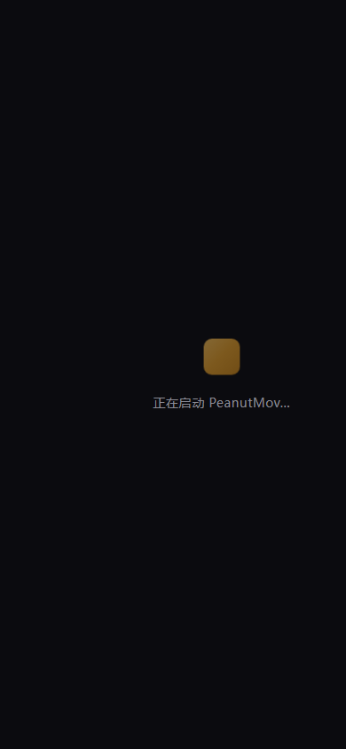

第一次打开进入合规页，列出四项要点：

1. 本 App 不内置、不提供、不分发任何影视片源，不提供破解、盗版聚合或 DRM 绕过能力。
2. 你添加的源与播放内容由你自行负责，仅可用于播放本人拥有版权或已获授权的内容。
3. 所有数据仅保存在本机，不上传服务器；无账号、无统计 SDK。
4. 内置演示内容为公开版权样片（Blender 开放影片），仅用于功能演示。

点「我已阅读并同意」进入首页；点「不同意，退出」在 Android 上提示退出，在浏览器上只提示并停留（没有跳过入口）。

同意后自动写入**内置演示源**（名称「内置演示」），包含 **12 条公开版权样片**、4 个分类（电影 / 电视剧 / 动漫 / 综艺），无需配置即可播放。首页分两块：

- **继续观看**：横滑卡片，来自观看历史；没有记录时整块不显示。
- **最近添加**：两列海报网格。

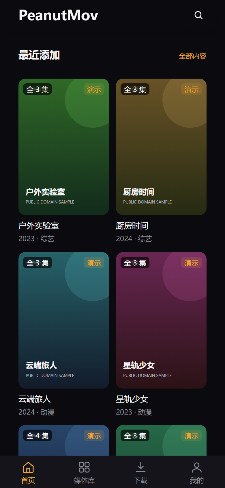

---

## 5. 添加片源

入口：底部「我的」→「片源管理」→ 右上角「+」新增源。页面顶部固定显示合规提示。

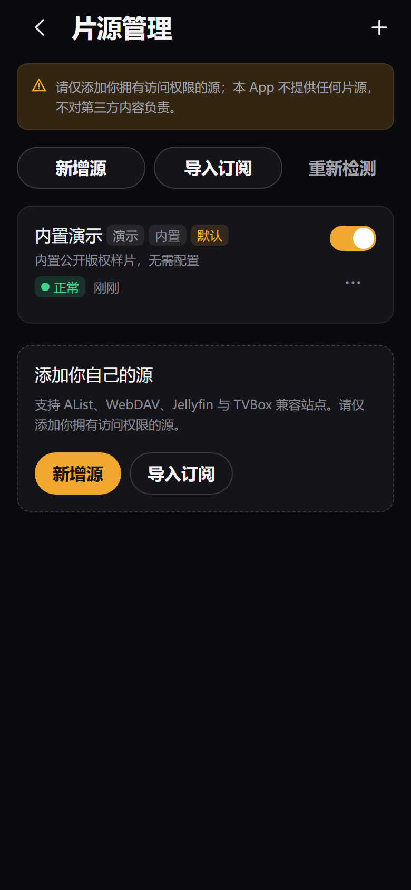

先选类型，四类源需要的字段如下（✓ 必填，○ 可选）：

| 字段 | AList | WebDAV | Jellyfin | 站点（TVBox 兼容） |
| --- | --- | --- | --- | --- |
| 名称 | ✓ | ✓ | ✓ | ✓ |
| 服务器地址 | ✓ 如 `https://alist.example.com` | ✓ 目录地址，如 `https://nas.example.com/dav` | ✓ 根地址，如 `https://jellyfin.example.com` | ✓ 接口根地址，如 `https://example.com/api.php/provide/vod` |
| 子路径 | ○ 如 `/Movies` | ○ 如 `/video` | ○ 一般留空 | ○ 一般留空 |
| 用户名 / 密码 | ○ 认证方式选 Basic 时填 | ○ 绝大多数用 Basic | — | — |
| Token | ○ 认证方式选 Token 时填 | ○ 同上 | — | — |
| API Key | — | — | ✓ 在后台「控制台 → API 密钥」创建 | — |
| 用户 ID | — | — | ○ 只读某个用户数据时填 | — |
| 自定义请求头 | — | — | — | ○ 每行一条 `名称: 值`，如 `Referer: https://example.com` |

服务器地址支持局域网 http；保存时会自动归一化末尾斜杠。

> **再次强调**：仅添加你有访问权限的源，不要把公开的第三方影视站点加进来。

### 5.1 「测试连接」是什么

表单底部的「测试连接」会用**当前填写的值**（无需先保存）真实访问一次源，超时 3 秒：

- 成功：提示「连接成功」并显示延迟毫秒数。
- 失败：提示具体原因，并建议先保存、稍后在源列表重试健康检查。

| 提示 | 常见原因 | 处理 |
| --- | --- | --- |
| 网络不可用 | 手机没网 / 离线 | 恢复网络后重试（离线时按钮不可用） |
| 认证失败 | 用户名、密码或 Token 错 | 重新复制凭据；Jellyfin 检查 API Key 是否有效 |
| 请求超时 | 地址不通、内网未连 VPN | 确认手机与 NAS 同网，或地址端口正确 |
| 配置有误 | 地址不是 http(s)、路径写错 | 补全 `http://` 或 `https://`，检查子路径 |
| 数据解析失败 | 该地址不是对应类型的接口 | 确认类型选对 |

保存后源列表显示健康徽标：正常 / 认证失败 / 连接超时 / 无法连接 / 配置有误 / 未检测。卡片右侧开关可临时禁用某个源；内置演示源不可删除，只能禁用。

---

## 6. 订阅导入

入口：「片源管理」→「导入订阅」，适合一次导入多个源。

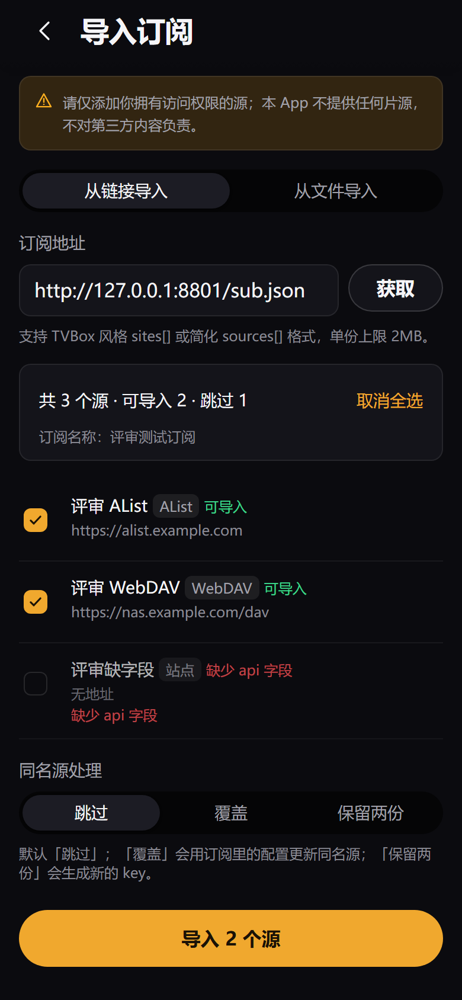

### 6.1 两种导入方式

- **从链接导入**：粘贴 http(s) 订阅地址，点「获取」。单份上限 2MB，10 秒超时。
- **从文件导入**：选择本地 `.json`，单文件上限 2MB。离线时只能用这种方式。

### 6.2 最小可导入示例（简化格式）

推荐手写这种结构，`sources` 数组里每个对象就是一个源：

```json
{
  "name": "我的订阅",
  "version": 1,
  "sources": [
    { "key": "home-alist", "name": "家里 AList", "type": "alist",
      "api": "https://alist.example.com",
      "ext": { "username": "reader", "password": "secret", "root": "/Movies" } },
    { "key": "home-jellyfin", "name": "Jellyfin", "type": "jellyfin",
      "api": "https://jellyfin.example.com",
      "ext": { "apiKey": "0123456789abcdef", "userId": "a1b2c3d4" } },
    { "key": "home-webdav", "name": "NAS WebDAV", "type": "webdav",
      "api": "https://nas.example.com/dav",
      "ext": { "username": "reader", "password": "secret", "root": "/video" } },
    { "key": "my-site", "name": "我自己的站点", "type": "site",
      "api": "https://my-site.example.com/api.php/provide/vod/",
      "searchable": 1, "headers": { "User-Agent": "Mozilla/5.0" }, "ext": null }
  ]
}
```

字段要点：

- 每条**必须**有 `key`（去重键，自己起名、全局唯一）、`name`、`type`、`api`。
- `type` 可写 `alist` / `webdav` / `jellyfin` / `site`，也可写数字 `3` / `4` / `5` / `0`（或 `1`）。
- `ext` 是各类型私有配置（账号、密码、API Key、子目录），也可写成 JSON 字符串。
- `searchable: 1` 表示该源支持搜索。

### 6.3 TVBox 风格 `sites[]` 最小示例

```json
{
  "sites": [
    { "key": "csp_MySite", "name": "我的站点", "type": 1,
      "api": "https://my-site.example.com/api.php/provide/vod/",
      "searchable": 1, "quickSearch": 0, "filterable": 1, "ext": "" },
    { "key": "alist_Home", "name": "家里 AList", "type": 3,
      "api": "https://alist.example.com",
      "ext": "{\"username\":\"reader\",\"password\":\"secret\"}" }
  ]
}
```

顶层用 `sites` 或 `sources` 二选一（同时存在取 `sites`）。`lives`、`parses`、`flags` 等不认识的字段会被忽略，不报错。

### 6.3.1 爬虫源（TVBox `type: 3`）

订阅里 `type: 3` 且 `api` 形如 `csp_XBPQ`、`py_cctv_full` 的条目，会被识别为**爬虫源**并正常导入：

- 爬虫 jar 由订阅的 `jar` 字段指定；该条没写 `jar` 时用订阅顶层的 `spider` 字段。
- 首次浏览时 App 会下载 jar（最多 8MB），校验 md5 后缓存到应用私有目录，之后不再重复下载。
- 爬虫在 App 内通过 `DexClassLoader` 执行，**仅 Android 可用**；网页版会提示「爬虫源仅支持在 App 内使用」。
- `api` 是 `drpy2.min.js` 这类 JS 脚本的条目也能导入，但当前版本不执行 JS 爬虫，预览页会标注警示。
  （2026-10-24 实测：95 个订阅仅解析出 15 个 drpy 源，其中自带播放能力的只有 4 个且均为直播/P2P 小众源，
  收益不足以支撑内置 JS 引擎，故暂不执行；若订阅生态变化可重新评估。）

> 爬虫能否出数据取决于 jar 与目标站点本身：源站反爬（HTTP 403）、域名失效、jar 里没有对应类，
> 都会表现为「该源暂不可用」。这类失败与导入无关，可在源管理里换用其它源。

**导入与体检建议（2026-10-24）**：

- **导入预检**：预览页会先探一遍每个爬虫条目的 jar 可达性，已失效的条目会标注
  「jar 不可达」并**默认不勾选**，导入前就能筛掉大半死源；
- **批量体检 + 一键隔离**：导入后在源管理页点「重新检测」，完成后若出现
  「禁用 N 个失效源」按钮，点它可一次禁用所有确定失效的源（「连接超时」的源保留，
  可能只是当时网络慢）；被禁用的源不参与浏览、搜索与豆瓣借播；
- 建议把订阅当消耗品：定期重导（同名源选「覆盖」）刷新配置，保持「只留活的」。

### 6.3.2 豆瓣源（发现源）

订阅里规则指向豆瓣的 drpy 源（如「聚玩盒子4K」）会被识别为**豆瓣源**，可以正常浏览：

- 提供 7 个分类：热门电影 / 热播剧集 / 热播综艺 / 电影筛选 / 电视筛选 / 电影榜单 / 电视榜单；
- 条目带海报、评分、年份、地区、获奖信息，详情页有简介、演员、导演；
- 支持搜索（按片名）。

**播放说明**：豆瓣只提供影视资料，不托管视频。点播放时 App 会用片名去**其它已启用的源**
（CMS 采集站 / jar 爬虫源）搜索，找到同名同年的影片就借用它的播放地址。

- 需要至少启用一个站点源或爬虫源，否则会提示「已启用的源里没有找到这部影片的可播放地址」；
- 片名必须完全一致、年份不能冲突，避免串到同名影片；宁可播不出来也不乱播。

### 6.4 重复源三种策略

预览页底部「同名源处理」，针对与**已有源 key 相同**的条目：**跳过**（默认，保留现有配置不导入该条）/ **覆盖**（用订阅里的配置更新同名源）/ **保留两份**（生成新的 key，两份都保留）。

### 6.5 怎么看导入结果

解析完成后先显示预览：顶部汇总 `共 N 个源 · 可导入 X · 跳过 Y`（可全选/取消全选）；逐条状态为可导入、配置无效（附原因，如缺 `key`/`name`/`api`）、已存在（与现有源 key 冲突）；下方单独列出「将跳过 N 个源」及原因。

点「开始导入」后弹出结果面板 `成功 X · 跳过 Y · 失败 Z`：

- **成功**：已写入并自动刷新源列表。
- **跳过**：含两类——预览阶段判定「配置无效」的条目，以及因同名策略「跳过」的条目。
- **失败**：写入过程出错。此时**整批回滚**，不会写入任何源，面板给出错误明细。

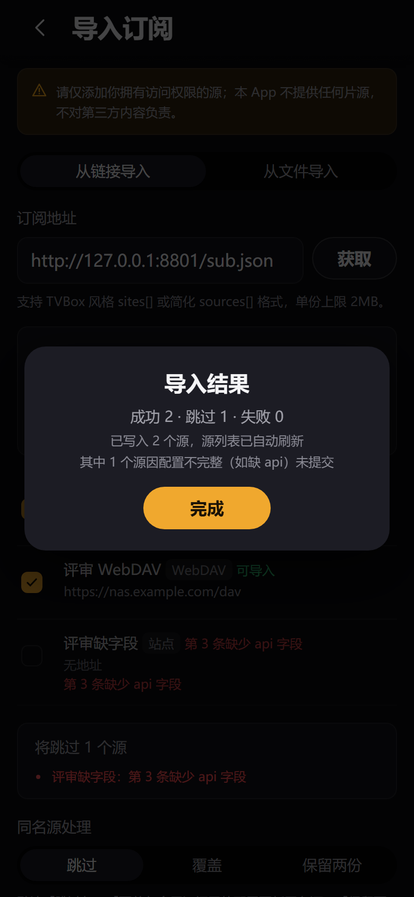

解析失败（非 JSON、无 `sites/sources`、数组为空、超过 500 条、超过 2MB）时不进入预览，页面保留你填的地址，改完再试。

---

## 7. 浏览与搜索

### 7.1 媒体库

底部「媒体库」。**分类 Tab** 由源返回的分类决定（演示源为电影 / 电视剧 / 动漫 / 综艺）；工具行左侧可切换「全部已启用源」或单个源；**筛选**支持类型、年代、地区三组组合，并显示已启用数量、可一键清除；右侧**刷新**按钮用于重新拉取（首版没有下拉刷新手势）；**无限滚动**滑到底部自动加载下一页，没有更多时底部提示到底。

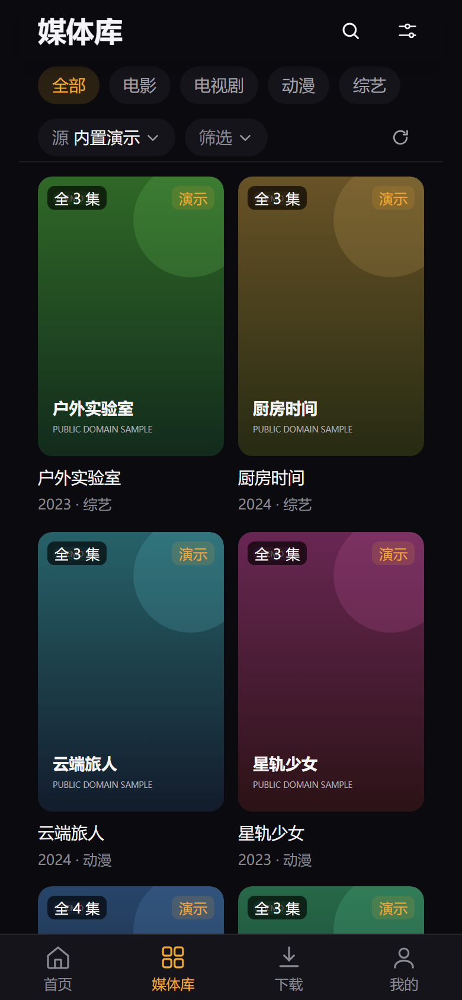

### 7.2 离线时

断网后页面顶部出现离线横幅「离线模式，展示本地缓存」，媒体库展示上次加载的缓存内容且不再翻页；已下载的剧集仍可正常播放。

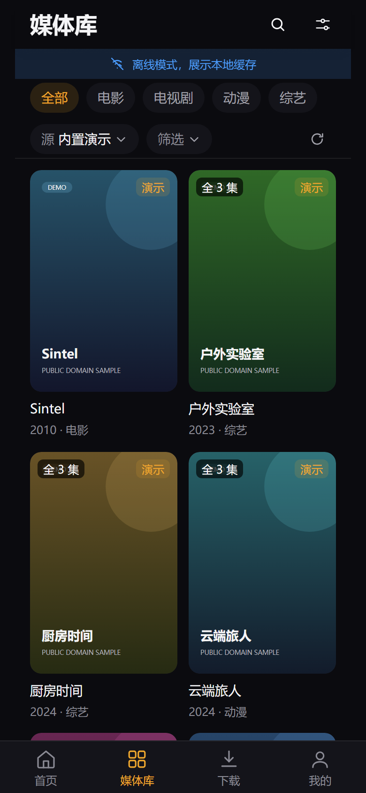

### 7.3 搜索

底部「搜索」，输入片名后 300ms 自动搜索（无需回车）。关键词为空时显示搜索历史，可单条删除或整体清空。搜索会并发查询已启用且声明支持搜索的源。

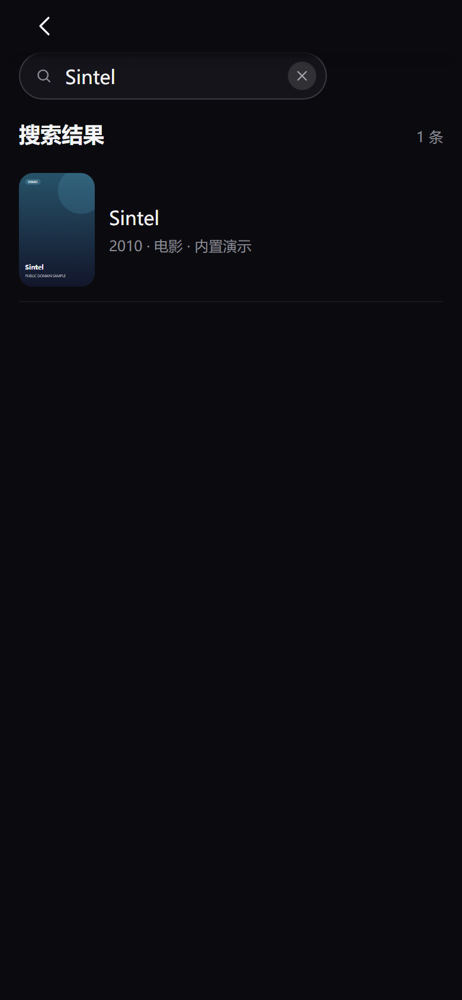

---

## 8. 详情与剧集

点任意海报进入详情页。

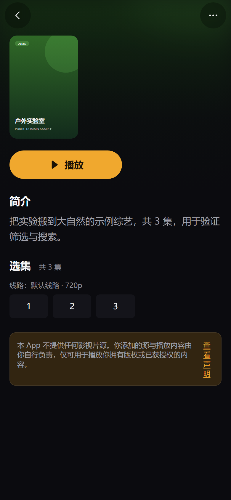

- **简介**：默认 4 行截断，点击展开。
- **线路**：多线路时显示选择器，切换保持当前集号。
- **选集**：显示「共 N 集」；点某一集直接播放。无可用地址时提示「该集暂无可播放地址」。
- **收藏**：右上角心形按钮，再点取消。
- **下载**：单集影片直接入队；多集或多线路打开选集抽屉，勾选后「开始下载」。重复下载提示「该集已在下载列表中」。
- **投屏**：与播放页一致，Android 调起系统选择器。
- **继续观看**：从历史进入时自动定位到上次观看的集。

线路播放失败时，App 回退原线路并提示「切换失败，已保持原线路」；原线路也不可用时提示「切换失败，原线路也无法播放」，此时请回详情页换线路或换源。

---

## 9. 播放

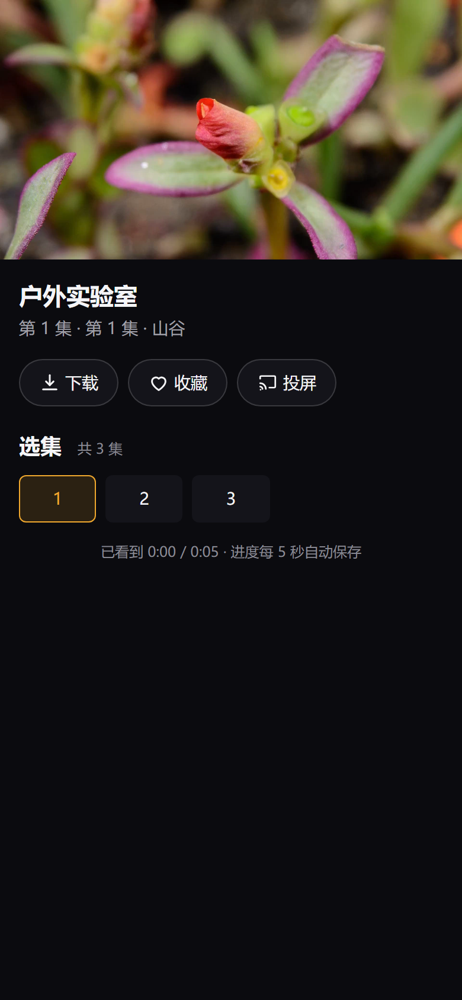

### 9.1 手势

| 手势 | 作用 | 反馈 |
| --- | --- | --- |
| 单击画面 | 显示 / 隐藏控制条 | 控制条 300ms 淡入淡出 |
| 双击左半屏 | 后退 10 秒 | 中央 HUD 显示目标时间 |
| 双击右半屏 | 前进 10 秒 | 中央 HUD 显示目标时间 |
| 水平拖动 | 快进 / 快退（松手才生效） | HUD「快进 00:32 / 后退 00:18」 |
| 左半屏上下滑 | 亮度（画面遮罩，保留最低亮度） | HUD 亮度条 + 百分比 |
| 右半屏上下滑 | 音量 0–100 | HUD 音量条；0 显示静音 |
| 长按画面 | 临时 2x 快进，松手恢复 | HUD「2x 快进中」 |

水平拖动最大跨度约 90 秒，快慢由「手势灵敏度」决定（低 0.6 / 中 1.0 / 高 1.5 倍）。多指触摸被忽略，避免误触。

### 9.2 倍速

控制条「1.5x」按钮打开面板：0.5 / 0.75 / 1 / 1.25 / 1.5 / 2。切换保持当前播放位置；设置页的「默认倍速」只影响下次播放。

### 9.3 字幕

控制条「CC」打开字幕面板：

- **轨道列表**：关闭字幕 / 源提供的远程字幕 / 你添加的本地字幕，当前项打勾。
- **本地字幕**：支持 `.srt` 与 `.vtt`，选择后立即生效。
- **加载失败**：该轨标「不可用」，点击重试一次；播放不受影响。
- **样式**：字号小/中/大、颜色白/黄、背景半透明黑/无。
- **时间偏移**：−5s ~ +5s，步进 0.5s，用于对齐口型。
- 片源无字幕时提示"可选择本地 SRT / VTT 文件外挂"。

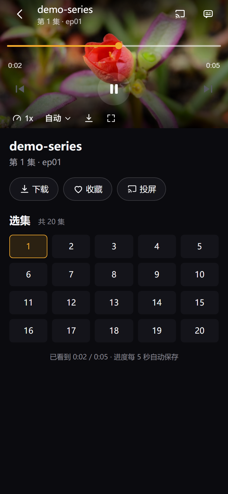

### 9.4 清晰度

控制条「清晰度」：HLS 多码率源列出 `auto / 1080p / 720p ...`；单一码率时提示「当前线路只有单一清晰度」。切换保持播放位置。

### 9.5 自动连播与断点续播

- **自动连播**：开启（默认）时一集播完出现 3 秒倒计时「即将播放第 N 集」，可取消；关闭时播完显示重播。
- **进度保存**：播放中每 5 秒写一次；暂停、拖动结束、离开页面、切后台时立即写回。
- **续播规则**：上次位置在 5%–95% 之间才继续；低于 5% 或高于 95% 从头开始。
- **看完判定**：进度 ≥ 95% 记为已看完，下次从头播放，历史显示为已完成。

### 9.6 全屏、横竖屏与切后台

- 控制条右下角全屏按钮：进入全屏并锁定横屏（Android 生效；浏览器只做 CSS 全屏，无法强制旋转）。Android 返回键先退出全屏，再按一次才返回上一页。
- 播放时保持屏幕常亮，离开播放页恢复系统设置。
- App 进入后台或锁屏立即暂停并保存进度（首版不做后台音频与画中画）。回到前台显示浮层「已暂停」，可选「继续播放」或「退出」。

---

## 10. 下载

入口：详情页「下载」按钮，或底部「下载」页查看队列。

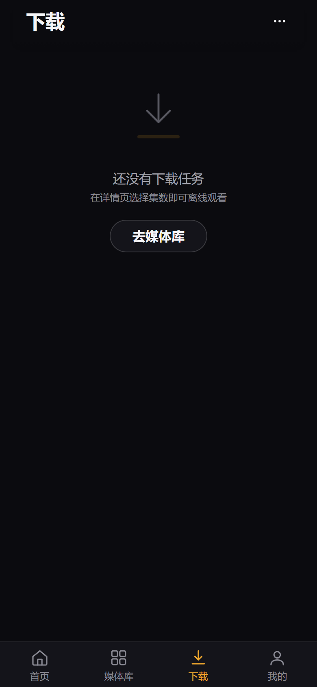

### 10.1 支持范围

- 仅支持**直链 MP4 / TS**。
- **HLS（.m3u8）分片下载为二期功能**，当前提示「HLS 分片下载暂不支持，请改用直链 MP4/TS」。

### 10.2 文件位置与队列操作

- **Web**：视频以 Blob 存进浏览器 IndexedDB；**Android**：存应用私有目录 `downloads/{mediaId}/{episodeId}.{ext}`，不出现在相册，卸载 App 即删除。
- 单任务可暂停、继续、失败重试、删除（同时删本地文件与记录）；批量操作用右上角「⋯」→ 全部暂停 / 全部继续 / 清除已完成记录 / 刷新。
- 状态筛选：全部 / 下载中 / 已完成 / 失败。
- 并发：默认同时下载 **2** 个，其余排队（先进先出）。并发值支持 1–3，首版设置页未单独暴露该开关。
- 流量提示：移动网络下单个任务预计超过 **500MB** 时先提示确认；若源站未返回文件大小可能无法预估而直接开始，建议大文件在 Wi-Fi 下下载。
- 回前台自动恢复：切后台时所有"下载中"转为"已暂停"并保留进度；回前台自动继续（设置项 `autoResume` 默认开启）。
- 下载完成的剧集断网仍可播放：详情页该集带下载标记，播放时优先使用本地文件。

---

## 11. 投屏

首版只做「调起系统能力」，不做 DLNA 设备发现。

- **Android**：播放页点「投屏」，App 先暂停播放，再调起系统投屏/分享选择器；选择电视或投屏应用即可。**需要真机**，模拟器通常没有可用目标。
- **浏览器**：不支持，点击提示「当前平台不支持投屏，请在 Android App 内使用」。
- 没有可用目标时提示「未找到可用的投屏目标」；主动取消提示「已取消投屏」。
- **DLNA / UPnP 设备发现与协议控制为二期功能**，当前不会扫描局域网设备。

---

## 12. 备份与恢复

入口：「我的」→「数据备份与恢复」。

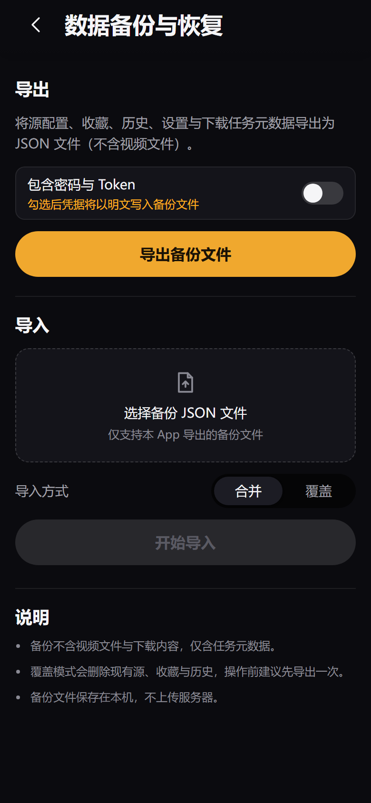

### 12.1 导出

导出内容：**源配置、收藏、观看历史、设置、下载任务元数据**。

- **不含视频文件**，也不含已下载的视频内容。
- **默认脱敏**：用户名、密码、Token 不明文写入。
- 勾选「包含密码与 Token」会弹二次确认，确认后凭据以**明文**写入 JSON，请勿上传到公共位置。
- 文件名形如 `peanutmov-backup-2026-10-20.json`。Web 触发浏览器下载；Android 写入文件后调起系统分享。

### 12.2 导入

1. 选择备份 `.json`（仅支持本 App 导出的文件）；预览显示 `源 N · 收藏 N · 历史 N · 下载 N`、schemaVersion 与导出时间。
2. 选择导入方式：**合并**（保留现有数据、按 key 合并）或**覆盖**（先删除现有源、收藏、历史，再写入，需二次确认，建议先导出一次）。
3. 点「开始导入」，成功提示「已导入 源X/收藏X/历史X（含设置）」。

注意：

- **下载任务不会被恢复**。备份里只有元数据，脱离视频文件与源缓存无法续传；导入不会生成"死任务"，需要重新下载。
- 导入在单个事务中完成，**任一步失败会整体回滚**，提示「导入失败，未导入任何数据」，不会留下半套数据。

---

## 13. 设置项逐条说明

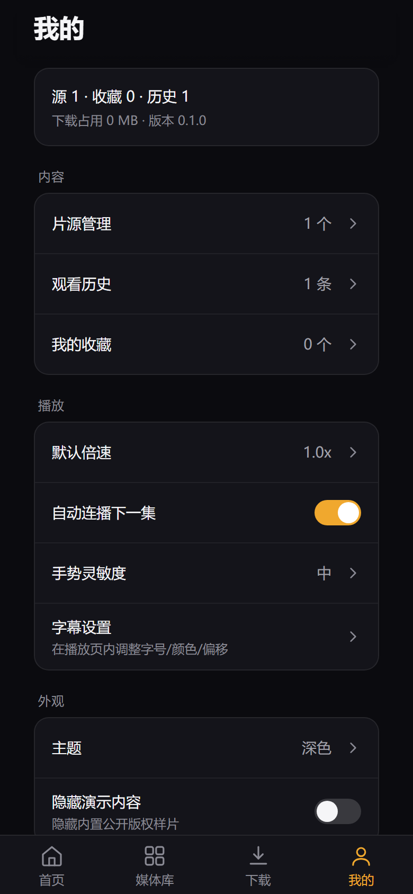

顶部是数据概览：`源 N · 收藏 N · 历史 N`，以及下载占用空间与版本号。下面共 15 行：

| # | 设置项 | 说明 |
| --- | --- | --- |
| 1 | 片源管理 | 进入源列表：新增、导入、启用/禁用、健康检查、编辑、删除 |
| 2 | 观看历史 | 所有观看记录与进度，可继续播放或删除单条 |
| 3 | 我的收藏 | 收藏的影片列表 |
| 4 | 默认倍速 | 0.5–2 共 6 档，下次播放生效；播放页内仍可临时切换 |
| 5 | 自动连播下一集 | 开关，默认开；关闭后播完只显示重播 |
| 6 | 手势灵敏度 | 低（拖动更稳）/ 中（推荐）/ 高（拖动更快），影响水平拖动跨度 |
| 7 | 字幕设置 | 仅作入口说明，实际字号/颜色/偏移在**播放页字幕面板**调整 |
| 8 | 主题 | 深色（默认）/ 浅色 / 跟随系统，立即生效 |
| 9 | 隐藏演示内容 | 打开后媒体库、搜索、继续观看都不再显示内置样片 |
| 10 | 数据备份与恢复 | 见第 12 章 |
| 11 | 清理缓存 | 清理**媒体元数据与分类缓存**（海报信息、线路、剧集列表），**保留历史、收藏、已下载内容**；之后进入媒体库会重新向源拉取 |
| 12 | 清空全部数据 | 删除源、收藏、历史、下载记录，不可恢复。弹层有「保留演示源（推荐）」勾选项，默认勾选；取消则连演示源一起删除，首页将变空 |
| 13 | 关于 PeanutMov | 版本号、DB 版本、开源许可、合规入口（连点版本号 7 次展开调试信息） |
| 14 | 合规声明 | 完整合规文本，可随时回看 |
| 15 | 源合规提示 | 「请仅添加你有访问权限的源」，点击跳到源管理 |

**「清理缓存」与「清空全部数据」的区别**：

| | 清理缓存 | 清空全部数据 |
| --- | --- | --- |
| 源配置 | 保留 | 删除（可勾选保留演示源） |
| 收藏 / 历史 | 保留 | 删除 |
| 已下载视频 | 保留 | 删除记录 |
| 媒体元数据 | 删除，之后重新拉取 | 删除 |
| 可恢复性 | 自动重建 | 只能靠备份恢复 |

---

## 14. 数据存在哪

| 数据 | Web | Android |
| --- | --- | --- |
| 源配置、收藏、历史、设置、下载任务 | 浏览器 IndexedDB | 应用私有存储（WebView 的 IndexedDB） |
| 已下载视频 | IndexedDB 中的 Blob | 应用私有目录 `downloads/...` |
| 备份文件 | 浏览器下载目录 | 你选择的保存位置（系统分享） |

- **不上传任何服务器**，没有账号、没有云同步、没有统计 SDK。
- Android 清单 `allowBackup="false"`，系统云备份（Google 备份/厂商云）**不会**带走 App 数据；换机或卸载后数据不会自动回来，请先用「导出备份」。
- 浏览器清理站点数据（"清除 Cookie 和网站数据"）会一并删除 IndexedDB，等同于清空 App 数据。
- 凭据以脱敏形式写入导出的备份，除非你主动勾选"包含密码与 Token"。

---

## 15. 常见问题

### 15.1 浏览器里源打不开 / 一直转圈（CORS 跨域）

浏览器要求源站返回允许跨域的响应头（`Access-Control-Allow-Origin`）。自建 NAS 通常没配置，因此会被拦截。处理顺序：① 优先用 **Android App**（原生层通过 CapacitorHttp 转发请求，不受跨域限制）；② 在源站/反向代理上为你的页面地址开启 CORS；③ 把 Web 版与源部署在同一域名下（同源）；④ 演示源本身已允许跨域，可用来验证是不是源的问题。

### 15.2 源失效了怎么办

1. 进入「片源管理」，看健康徽标（认证失败 / 连接超时 / 无法连接 / 配置有误）。
2. 点开该源「编辑」→「测试连接」，按提示修正地址或凭据。
3. 内置演示源被禁用或清空时，源列表顶部出现「恢复演示源」，点一下重建 12 条样片。
4. 站点源接口变更（返回结构变了）通常表现为「数据解析失败，源可能已变更」，需要换源。

### 15.3 提示"暂不支持该格式"

- 播放：确认地址是 MP4 / WebM / HLS（m3u8）。DRM 加密内容不支持，会提示"不支持受保护内容"。
- 下载：只支持直链 MP4 / TS；HLS 分片下载是二期功能。

### 15.4 下载好的本地文件被删了

常见于手动清理了 App 数据或存储空间不足。播放时检测到文件缺失，提示「本地文件不可用，已切换网络源」并自动回退在线播放；也可到下载页删除该任务后重新下载。

### 15.5 离线时能做什么

- 能看：已下载的剧集、已缓存的媒体库/详情页、收藏与历史（本地数据）。
- 不能做：在线播放未下载内容、搜索新内容、刷新媒体库、测试连接、从链接导入订阅。
- 页面顶部出现「离线模式」横幅，网络恢复后自动消失。

### 15.6 清空数据后怎么恢复

- 只删了演示源：源列表顶部「恢复演示源」。
- 有备份：设置 →「数据备份与恢复」→ 选择 JSON → 合并导入。
- 没有备份：只能重新添加源；收藏与历史无法找回。

### 15.7 APK 安装被拦截

- 提示"未知来源"：在系统设置中允许当前应用安装未知应用。
- 提示"应用未安装"：先卸载旧版本再装，或确认 APK 完整（约 4.8 MB）。
- 厂商安全中心（华为/小米等）可能二次扫描，选择"继续安装"。
- 仍失败时用数据线 `adb install app-debug.apk`，能看到具体错误。

### 15.8 投屏按钮没反应

浏览器不支持，会提示"当前平台不支持投屏"；Android 模拟器通常没有投屏目标，请用真机，并确保手机与电视在同一 Wi-Fi。

---

## 16. 附录

### 16.1 演示源包含什么

内置演示源「内置演示」共 **12 条**，全部为公开版权或公开测试素材，仅用于验证功能：

- **Blender 基金会开放影片**：Big Buck Bunny、Sintel、Tears of Steel、Elephants Dream。
- **公开示例短片**：MDN / Google 示例视频（flower、friday、rabbit320 等）。
- **公开测试流**：Mux 提供的 HLS 多码率测试流（Big Buck Bunny），用于验证清晰度切换。
- 覆盖电影 / 电视剧 / 动漫 / 综艺 4 个分类；Sintel 含 MP4 与 HLS 两条线路，可测试线路切换。
- 海报为内联 SVG，离线也能显示；视频本身需要联网。

这些素材与任何第三方影视平台无关，也不代表 App 提供片源。

### 16.2 键盘快捷键（仅桌面浏览器播放页）

| 按键 | 作用 |
| --- | --- |
| `空格` | 播放 / 暂停 |
| `←` / `→` | 后退 / 前进 10 秒 |
| `↑` / `↓` | 音量 +5 / −5 |
| `F` | 进入 / 退出全屏 |
| `Esc` | 退出全屏 |

输入框获得焦点时快捷键不生效。Android App 无物理键盘支持，请使用手势。

### 16.3 相关文档

需求范围与场景见 `docs/01-需求/需求规格说明书.md`；技术实现见 `docs/02-方案/技术方案.md`；页面结构与交互见 `docs/03-设计规范/页面蓝图.md`；界面截图见 `docs/03-设计规范/preview/`。

---

*本手册描述首版（v0.1.0）实际行为；未实现的能力（DLNA 投屏、HLS 分片下载、后台音频、云同步、账号体系）已在文中标注为二期或不支持。*
